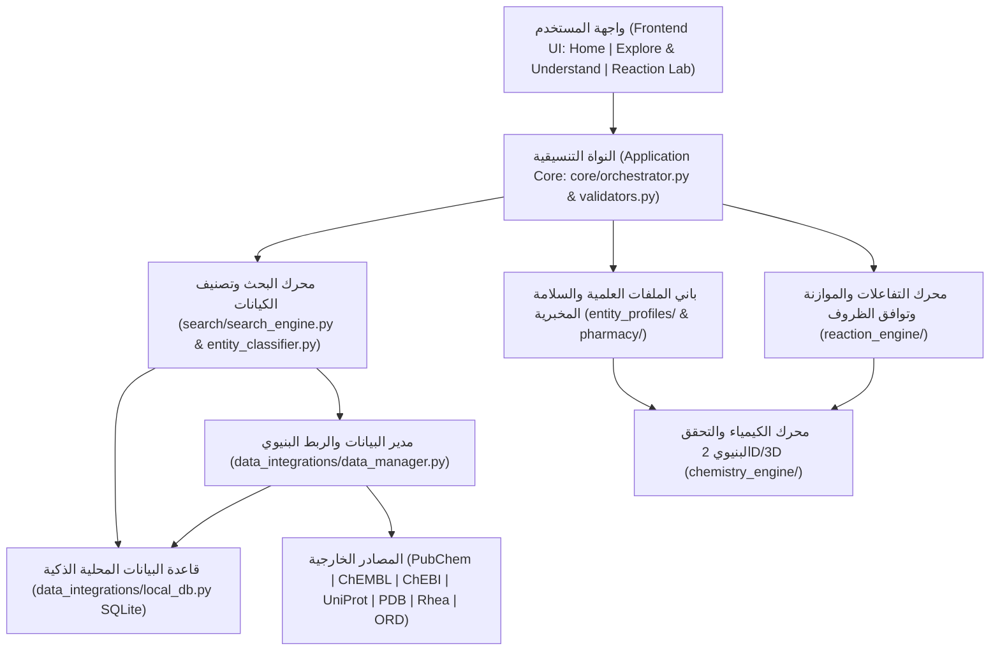

# MolecuLens
**Scientific Learning & Exploration Platform**  
**الشعار (Slogan):** See Molecules. Understand Science.  
**الفريق التطويري (Development Team):** BioCode

---

## 1. الفكرة العامة للمنصة (Platform Overview)
**MolecuLens** هي منصة تعليمية واستكشافية علمية تفاعلية باللغة العربية والمصطلحات العلمية ثنائية اللغة، مصممة لتمكين طلاب الصيدلة والعلوم من استكشاف المواد الكيميائية والدوائية والحيوية وفهم تركيبها وخصائصها وإرشادات سلامتها المخبرية قبل دخول المختبر (`Pre-Lab Simulation`)، أو دخول مختبر التفاعلات لتحليل المعادلات والحسابات الكيميائية المولية والستوكيومترية بدقة، حيث تتولى النواة العلمية المشتركة (`Scientific Core`) عمليات البحث الذكي، وتصنيف الكيانات، والتحقق المزدوج من هوية المركبات، وتوحيد البيانات، وإجراء الحسابات الحتمية دون تخمين.

تتكون المنصة من قسمين رئيسيين:
1. **Explore & Understand (استكشاف المادة وفهم خصائصها):** استكشاف العناصر والمركبات الكيميائية والمواد الدوائية والبروتينات عبر خانة بحث واحدة موحدة وذكية، وعرض معلوماتها الأساسية، وتركيبها الذري، وبنيتها ثنائية وثلاثية الأبعاد (`2D & 3D Structure Viewer`)، ومحددات ليبينسكي الدوائية (`Lipinski Rule of Five`)، وبطاقة تهيئة وسلامة طالب الصيدلة قبل المختبر (`Pharmacy Pre-Lab Safety & QC Protocol`)، والتفسير العلمي المتدرج بمستويين (مبسط للطالب وجامعي متقدم).
2. **Reaction Lab (مختبر التفاعلات والحسابات الكيميائية):** اختيار مجال التفاعل والمواد المتفاعلة والكميات والوحدات وظروف التفاعل عبر قوائم مغلقة حصراً (`Closed Dropdowns`)، والتحقق من توافق المجال وظروف التفاعل (`الحرارة، الضغط، المذيب، الحفاز`) ومنع تطبيق الحجم الغازي القياسي (`L_STP`) على المواد الصلبة والسائلة، وتحليل المعادلة الموزونة جبرياً باتجاه قياسي موحد (`LTR`) وأرقام سفلية صحيحة (`H₂O`)، وحساب المتفاعل المحدد (`Limiting Reagent`) والفائض (`Excess Reagent`) والناتج النظري (`Theoretical Yield`)، مع الفصل البصري الواضح بين السجل الموثق والنتيجة المحسوبة والتوقع النظري.

---

## 2. إحصائيات قاعدة البيانات العلمية المعتمدة (Verified Database Statistics)
- **المواد العلمية الموثقة في السجل المحلي (`LOCAL_SCIENTIFIC_CATALOG`):** **241 مادة علمية** موثقة ومفهرسة بالكامل (مجموع الفئات الـ 15 يساوي **241 مادة** بالضبط):
  1. **118 عنصراً كيميائياً (`element`):** الجدول الدوري الكامل وفق معايير `IUPAC` بالعربية والإنجليزية.
  2. **23 ملحاً كيميائياً رئيسياً (`salt`):** تشمل الأملاح التحليلية والدوائية مثل `NaCl`، `NaHCO₃`، `AgNO₃`، `KMnO₄`، `K₂Cr₂O₇`، `FeSO₄`، `BaSO₄`.
  3. **22 مركباً غير عضوي أساسياً (`inorganic_compound`):** تشمل الأكاسيد والغازات والأحماض غير العضوية مثل `H₂O`، `CO₂`، `NH₃`، `H₂O₂`، `CaO`، `ZnO`.
  4. **11 جزيئاً حيوياً وبروتيناً (`biomolecule`):** تشمل الإنسولين البشري، إنزيم `DPP-4`، الهيموجلوبين البشري، `ATP`، `NADH`، الجلوكوز، الفركتوز، الجالاكتوز، السكروز، اليوريا، والجلايسين.
  5. **10 أيونات كيميائية موجبة وسالبة (`ion`):** تشمل `H₃O⁺`، `OH⁻`، `NH₄⁺`، `SO₄²⁻`، `NO₃⁻`، `CO₃²⁻`، `PO₄³⁻`، `Cl⁻`، `Na⁺`، `Ca²⁺`.
  6. **9 مواد دوائية وصيدلانية (`drug`):** تشمل سيتاجليبتين (`Sitagliptin`)، فيلداجليبتين (`Vildagliptin`)، ميتفورمين (`Metformin`)، الأسبرين (`Aspirin`)، الباراسيتامول (`Paracetamol`)، الإيبوبروفين (`Ibuprofen`)، الكافيين (`Caffeine`)، الأموكسيسيلين (`Amoxicillin`)، والأوميبرازول (`Omeprazole`).
  7. **9 قواعد كيميائية قوية وضعيفة (`base`):** تشمل `NaOH`، `KOH`، `Ca(OH)₂`، `Mg(OH)₂`، `Ba(OH)₂`، `Al(OH)₃`، `LiOH`، `NH₄OH`، والأمونيا.
  8. **8 مركبات عطرية (`aromatic_compound`):** البنزين العطري، التولوين، الفينول، الأنيلين، النيتروبنزين، النفثالين، حمض البنزويك، وحمض الساليسيليك.
  9. **7 مركبات عضوية هيدروكربونية وإيثرية (`organic_compound`):** الميثان (`CH₄`)، الإيثان (`C₂H₆`)، البروبان (`C₃H₈`)، البيوتان (`C₄H₁₀`)، الإيثيلين (`C₂H₄`)، الأسيتيلين (`C₂H₂`)، وثنائي ميثيل إيثر (`CH₃OCH₃`).
  10. **7 أحماض معدنية وكيميائية (`acid`):** `HCl`، `H₂SO₄`، `HNO₃`، `H₃PO₄`، `H₂CO₃`، `HF`، `HBr`.
  11. **5 كحولات عضوية (`alcohol`):** الميثانول، الإيثانول، الأيزوبروبانول، البروبانول، والجليسرول.
  12. **4 أحماض كربوكسيلية عضوية (`carboxylic_acid`):** حمض الخليك (`CH₃COOH`)، حمض الفورميك (`HCOOH`)، حمض الستريك (`C₆H₈O₇`)، وحمض اللاكتيك (`C₃H₆O₃`).
  13. **3 ألدهيدات عضوية (`aldehyde`):** الفورمالديهايد، الأسيتالديهايد، والبنزالديهايد.
  14. **3 إسترات عضوية (`ester`):** أسيتات الإيثيل، أسيتات الميثيل، وفورمات الميثيل (`HCOOCH₃`).
  15. **2 كيتون عضوي (`ketone`):** الأسيتون والبيوتانون.
- **المرادفات العلمية المفهرسة محلياً:** **1453 مرادفاً** واختصاراً واسماً علمياً وتجارياً مفهرساً في قاعدة البيانات المحلية (`SQLite`) لتسريع البحث المباشر.
- **التفاعلات الكيميائية الموثقة (`VERIFIED_REACTIONS_REGISTRY`):** **87 تفاعلاً كيميائياً** موثقاً بمراجع علمية (`NIST / IUPAC / USP / Vogel's / ORD / Rhea`) وموزوناً بدقة، تغطي:
  - تفاعلات التعادل والأحماض والقواعد (`14 تفاعلاً`).
  - تفاعلات الاحتراق الكامل للهيدروكربونات والكحولات (`10 تفاعلات`).
  - تفاعلات الترسيب والتبادل المزدوج (`8 تفاعلات`).
  - تفاعلات الإحلال المفرد (`9 تفاعلات`).
  - تفاعلات الاتحاد والأكسدة والاختزال (`21 تفاعلاً`).
  - تفاعلات التفكك والتحلل الحراري (`9 تفاعلات`).
  - التفاعلات العضوية الموثقة وفق `ORD` (`10 تفاعلات`: الأسترة، الهدرجة، الإماهة، الهلجنة، النترتة).
  - التفاعلات الكيميائية الحيوية وفق `Rhea` (`6 تفاعلات`: التنفس الخلوي، التخمر الكحولي، البناء الضوئي، تحلل `ATP`، تحلل السكروز واليوريا).

---

## 3. الميزات الهندسية والتطويرية المنفذة (Implemented Engineering Features)

### 1. توحيد خانة البحث الذكي والتحقق من هوية المركبات (Unified Search & Identity Verification)
- خانة بحث نصية واحدة وحيدة في واجهة الاستكشاف (`Explore & Understand`) تتعرف تلقائياً على نوع المدخل (`اسم عربي`، `اسم إنجليزي`، `صيغة جزيئية`، `صيغة بنائية مكثفة مثل CH3COOH`، `رمز عنصر`، `تمثيل SMILES`، `اسم نظامي IUPAC`).
- دعم الصيغ الجزيئية والمكثفة واختلافات الترقيم السفلي (`H2O` و `H₂O`) مع عرض جميع الصيغ بالأرقام السفلية الصحيحة.
- التحقق المزدوج من هوية المركب (`verify_substance_structure_identity`): لا يكتفي النظام بنجاح قراءة `SMILES`، بل يتحقق من تطابق الصيغة الجزيئية المستخرجة ومعرفات السجل (`CID / ChEMBL / ChEBI / InChIKey`) لمنع الخلط بين المصاوغات (`Isomers`) مثل حمض الخليك (`CH₃COOH`) وفورمات الميثيل (`HCOOCH₃`).

### 2. تكامل المصادر العلمية والربط البنيوي (Cross-Database Structure Matching & ORD Integration)
- قاعدة بيانات محلية مدمجة (`SmartLocalDatabase` في `data/moleculens_local.db` عبر `SQLite`) مع إدارة اتصالات آمنة.
- ربط ذكي بين `PubChem` و `ChEMBL` و `ChEBI` عبر الدالة `match_records_by_structure_and_identifiers` باستخدام المعرفات البنيوية (`InChIKey` و `Canonical SMILES` والصيغة الجزيئية) بدلاً من الاعتماد على تطابق الاسم النصي فقط.
- تكامل فعلي مع قاعدة بيانات التفاعلات العضوية المفتوحة (`Open Reaction Database — ORD`) عبر `search_ord_reactions` وقاعدة `Rhea` للتفاعلات الحيوية مع اشتراط تحقق قانون حفظ الذرات.

### 3. محرك التفاعلات وضوابط الدقة العلمية (Reaction Lab Engine & Scientific Guards)
- **فلترة مجال التفاعل (`Domain Filtering`):** تطبيق الفلترة الفعلية حسب المجال المختار (`الكيمياء العامة`، `الأحماض والقواعد`، `الأكسدة والترسيب`، `الكيمياء العضوية — ORD`، `الكيمياء الحيوية — Rhea`) على كل من تحليل التفاعلات والبحث عن تفاعلات المواد.
- **التحقق من توافق ظروف التفاعل (`Conditions Compatibility Check`):** مقارنة درجة الحرارة والضغط والمذيب والعامل الحفاز المختارة من المستخدم مع الظروف المرجعية للتفاعل الموثق وتنبيه الطالب عند وجود تعارض حراري أو حفزي أو تمسخ إنزيمي.
- **ضبط وحدات الحجم القياسي (`STP Gas Volume Validation`):** قصر تحويل الحجم المولي القياسي (`L_STP = 22.414 L/mol`) على الغازات حصراً، ورفض تطبيقه علمياً على المواد الصلبة أو السائلة أو المحاليل المائية مع تقديم رسالة توجيهية واضحة.
- **الفصل البصري الثلاثي (`Three-Way Visual Separation`):** فصل النتائج بصرياً في بطاقات مميزة بين **(1) التفاعل الموثق (`Documented Reaction`)**، و**(2) النتيجة المحسوبة (`Calculated Result`)**، و**(3) التوقع النظري والافتراضات (`Theoretical Prediction`)**.

---

## 4. المخطط المعماري للنظام (System Architecture)



---

## 5. تشغيل الاختبارات الآلية (Automated QA Test Suite)

تحتوي المنصة على منظومة اختبارات برمجية شاملة تضم **103 اختبارات آلية** بنسبة نجاح **100%**:

```bash
pytest -v
```

مخرجات الاختبارات حسب الوحدات:
- `tests/test_platform_upgrade.py`: اختبارات التعرف على الصيغ والمصاوغات، والتمييز الأصفر، والبحث الموحد، وقوائم الاختيار المغلقة، ودقة التراكيب 2D/3D، وقاعدة البيانات المحلية، وفلترة التفاعلات.
- `tests/test_chemistry.py`: اختبارات تنسيق الصيغ والمعادلات بالأرقام السفلية (`H₂O`)، والتحقق من الطور الغازي عند `STP`، والتحقق المزدوج من هوية المركبات.
- `tests/test_reaction_engine.py`: اختبارات الموازنة الجبرية، وحفظ الذرات، والمتفاعل المحدد، وفلترة المجالات، وتوافق ظروف التفاعل، ورفض `L_STP` للمواد الصلبة والسائلة.
- `tests/test_core_and_data_manager.py`: اختبارات تصنيف الكيانات، والربط البنيوي عبر `InChIKey / SMILES`، وتكامل `ORD`، والمدققات العلمية.
- `tests/test_smart_search.py`: اختبارات البحث متعدد اللغات والتصحيح الإملائي.
- `tests/test_entity_profiles.py` و `tests/test_mvp_scenarios.py`: اختبارات الملفات العلمية للعناصر والمركبات والأدوية والبروتينات وسيناريوهات المنصة.

---

## 6. تشغيل المنصة (Running the Application)

```bash
streamlit run app.py
```
