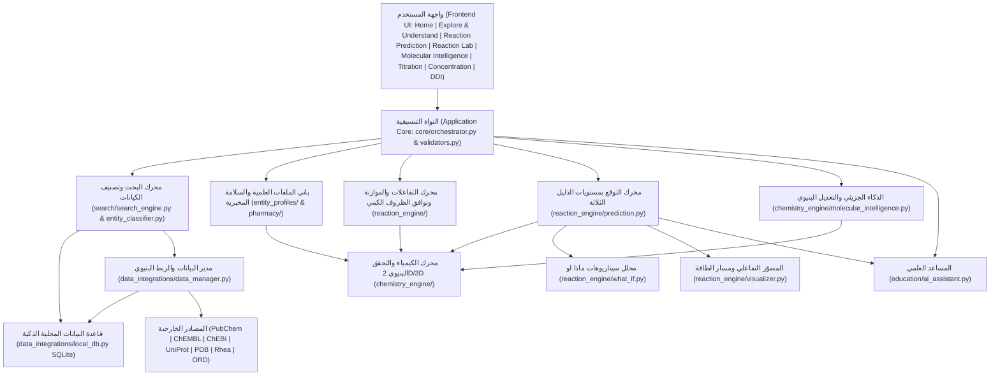

# MolecuLens
**Scientific Learning & Exploration Platform**  
**الشعار (Slogan):** See Molecules. Understand Science.  
**الفريق التطويري (Development Team):** BioCode

> **English summary (for judges):** MolecuLens is a bilingual (Arabic/English) learning platform for pharmacy and science students. It searches substances, shows 2D/3D structures, explains safety data, and computes reactions **only when they are documented or follow a verified general rule**. It never invents a reaction. Its LogP module separates the deterministic Wildman-Crippen calculation from a trained Ridge QSAR model that is validated with a holdout split, 5-fold CV, and a leave-one-chemical-class-out test, and always compared against Crippen. Reproduce the numbers with `python scripts/evaluate_logp.py`.

## ما لا يدّعيه المشروع (Scope & Honest Limits)
- التعديل البنيوي افتراضي (`in silico`): لا يمثل تفاعلاً مخبرياً مثبتاً ولا يقول شيئاً عن الظروف أو المردود أو الانتقائية الموقعية، ولا يُثبت تحسن النفاذية أو الفعالية.
- نموذج QSAR مبني على مجموعة صغيرة نسبياً (120 مركباً) من سلاسل متجانسة؛ التقسيم العشوائي متفائل، والتحقق بحجب الفئة الكيميائية هو المقياس الأصدق، وقد لا يتفوق النموذج على Crippen.
- تدقيق المراجع في السجل فحص شكلي (وجود المعرّف والنص والرابط)، ولا يثبت أن الصفحة المذكورة تدعم التفاعل؛ عدد المراجع المُتحقَّق منها يدوياً يظهر في تقرير التدقيق (`REFERENCE_VERIFIED_IDS`).
- المشروع تعليمي ولا يُستخدم لقرارات علاجية أو سلامة مخبرية.

---

## 1. الفكرة العامة للمنصة (Platform Overview)
**MolecuLens** هي منصة تعليمية واستكشافية علمية تفاعلية باللغة العربية والمصطلحات العلمية ثنائية اللغة، مصممة لتمكين طلاب الصيدلة والعلوم من استكشاف المواد الكيميائية والدوائية والحيوية وفهم تركيبها وخصائصها وإرشادات سلامتها المخبرية قبل دخول المختبر (`Pre-Lab Simulation`)، أو دخول مختبر التفاعلات لتحليل المعادلات والحسابات الكيميائية المولية والستوكيومترية بدقة، حيث تتولى النواة العلمية المشتركة (`Scientific Core`) عمليات البحث الذكي، وتصنيف الكيانات، والتحقق المزدوج من هوية المركبات، وتوحيد البيانات، وإجراء الحسابات الحتمية دون تخمين أو اختراع قيم افتراضية.

تتكون المنصة من سبعة مختبرات ووحدات رئيسية:
1. **Explore & Understand (استكشاف المادة وفهم خصائصها والمساعد الذكي):** استكشاف العناصر والمركبات الكيميائية والمواد الدوائية والبروتينات عبر خانة بحث واحدة موحدة وذكية، وعرض معلوماتها الأساسية، وتركيبها الذري، وبنيتها ثنائية وثلاثية الأبعاد البارزة (`2D & 3D Structure Viewer`)، ومحددات ليبينسكي الدوائية (`Lipinski Rule of Five`)، وبطاقة تهيئة وسلامة طالب الصيدلة قبل المختبر (`Pharmacy Pre-Lab Safety & QC Protocol`)، والتفسير العلمي المتدرج بمستويين (مبسط للطالب وجامعي متقدم) مدعوماً بمساعد الذكاء الاصطناعي (`AI Scientific Assistant`).
2. **Reaction Prediction (مختبر التوقع — المختبر الافتراضي):** إدخال حر لأي مادتين أو أكثر (بالاسم العربي أو الإنجليزي، أو بالصيغة الكيميائية، أو `SMILES`) والسؤال المباشر: **هل سيحدث تفاعل؟ وما نواتجه؟ وما التغيّر في الحموضة والملاحظات المتوقعة؟**، مع ترتيب نتائج المحرك على ثلاثة مستويات دليل صريحة: **تفاعل موثّق** بمرجع علمي محدّد، أو **استنتاج قواعدي** من قاعدة كيميائية معلنة مع ذكر مصدرها وحدودها، أو **غياب الأدلة** صراحةً — ولا يختلق أي ناتج غير موثّق في الحالتين الأخيرتين. يرافقه التمثيل البصري الجزيئي ثنائي الأبعاد، وتدقيق حفظ الذرات، وتحليل تكسر وتكون الروابط ومخطط مسار الطاقة التفاعلي (`Plotly Reaction Energy Coordinate`)، ومحلل سيناريوهات ماذا لو (`What-If Analysis`).
3. **Reaction Lab (مختبر التفاعلات والحسابات الكيميائية):** اختيار مجال التفاعل والمواد المتفاعلة والكميات والوحدات وظروف التفاعل عبر قوائم مغلقة حصراً (`Closed Dropdowns`)، والتحقق الكمي المنهجي من توافق المجال وظروف التفاعل (`درجة الحرارة بالوحدات المختلفة °C/K/°F، الضغط atm/kPa/bar، المذيب، الحفاز`) ومنع تطبيق الحجم الغازي القياسي (`L_STP`) على المواد الصلبة والسائلة، وتحليل المعادلة الموزونة جبرياً باتجاه قياسي موحد (`LTR`) وأرقام سفلية صحيحة (`H₂O`)، وحساب المتفاعل المحدد (`Limiting Reagent`) والفائض (`Excess Reagent`) والناتج النظري (`Theoretical Yield`)، مع الفصل البصري الواضح بين السجل الموثق والنتيجة المحسوبة والتوقع النظري.
4. **Molecular Intelligence (الذكاء الجزيئي والتعديل البنيوي):** حساب بصمات مورغان الجزيئية (`Morgan Fingerprints`) ومعامل تشابه تانيموتو (`Tanimoto Similarity`) للعثور على أقرب المركبات بنيوياً في السجل العلمي، ومحرر **التعديل البنيوي الافتراضي (`in silico`)** للمجموعات الوظيفية عبر `SMARTS` مع فحوصات سلامة متعددة الخطوات (التكافؤ، الشظية المفردة، انعدام الجذور الحرة، تنبيهات الاستقرار، ومطابقة السجل المحلي) دون ادعاء تحسين النفاذية أو الفعالية الدوائية تلقائياً، إلى جانب الفصل الصريح بين حساب `cLogP` الحتمي (Wildman-Crippen بدون فواصل ثقة اصطناعية) ونموذج انحدار `Ridge QSAR` المُدرَّب والمُقيَّم فعلياً على **120 مركباً مرجعياً** ببيانات `LogP` تجريبية موثقة (`90` للتدريب / `30` للاختبار المحجوز + تحقق متقاطع `5-Fold Cross-Validation`).
5. **Titration Lab (مختبر المعايرة الافتراضي):** محاكاة تفاعلات الأحماض والقواعد القوية والضعيفة، وحساب نقاط التكافؤ ونصف التكافؤ وسعة المحاليل المنظمة ومعادلة هندرسون-هاسلبالخ، مع رسم بياني تفاعلي لمنحنيات pH عبر Plotly ونطاقات تحول الكواشف اللونية.
6. **Concentration Lab (حاسبة التراكيز وإعداد المحاليل):** حساب المولارية (M)، العيارية (N)، أجزاء المليون والمليار (ppm/ppb)، والنسب المئوية (% w/w, % w/v, % v/v)، وقانون التخفيف C1V1 = C2V2 وتوليد بروتوكولات تحضير معملية خطوة بخطوة.
7. **Drug Interactions - DDI (فاحص التداخلات الدوائية):** فحص التداخلات الثنائية والوصفات المتعددة، وتحديد الآليات الحركية والديناميكية، والأثر السريري، وتوصيات التدبير، والمراجع العلمية، والتنبيه السريري الإلزامي.

---

## 2. إحصائيات قاعدة البيانات العلمية المعتمدة (Verified Database Statistics)
- **المواد العلمية الموثقة في السجل المحلي (`LOCAL_SCIENTIFIC_CATALOG`):** **241 مادة علمية** موثقة ومفهرسة بالكامل (مجموع الفئات الـ 15 يساوي **241 مادة** بالضبط):
  1. **118 عنصراً كيميائياً (`element`):** الجدول الدوري الكامل وفق معايير `IUPAC` بالعربية والإنجليزية.
  2. **23 ملحاً كيميائياً رئيسياً (`salt`):** تشمل الأملاح التحليلية والدوائية مثل `NaCl`، `NaHCO₃`، `AgNO₃`، `KMnO₄`، `K₂Cr₂O₇`، `FeSO₄`، `BaSO₄`.
  3. **22 مركباً غير عضوي أساسياً (`inorganic_compound`):** تشمل الأكاسيد والغازات والأحماض غير العضوية مثل `H₂O`، `CO₂`، `NH₃`، `H₂O₂`، `CaO`، `ZnO`.
  4. **11 جزيئاً حيوياً وبروتيناً (`biomolecule`):** تشمل الإنسولين البشري، إنزيم `DPP-4`، الهيموجلوبين البشري، `ATP`، `NADH`، الجلوكوز، الفركتوز، الجالاكتوز، السكروز، اليوريا، والجلايسين.
  5. **10 أيونات كيميائية موجبة وسالبة (`ion`):** تشمل `H₃O⁺`، `OH⁻`، `NH₄⁺`، `SO₄²⁻`، `NO₃⁻`، `CO₃²⁻`، `PO₄³⁻`، `Cl⁻`، `Na⁺`، `Ca²⁺`.
  6. **9 مواد دوائية وصيدلانية (`drug`):** تشمل سيتاجليبتين (`Sitagliptin`)، فيلداجليبتين (`Vildagliptin`)، ميتفورمين (`Metformin`)، الأسبرين (`Aspirin`)، الباراسيتامول (`Paracetamol`)، الإيبوبروفين (`Ibuprofen`)، الكافيين (`Caffeine`)، الأموكسيسيلين (`Amoxicillin`)، والأوميبرازول (`Omeprazole`).
  7. **9 قواعد كيميائية قوية وضعيفة (`base`):** تشمل `NaOH`، `KOH`، `Ca(OH)₂`، `Mg(OH)₂`، `Ba(OH)₂`، `Al(OH)₃`، `LiOH`، `NH₄OH`، والأمونيا.
  8. **8 مركبات عطرية (`aromatic_compound`):** البنزين العطري، التولوين، الفينول، الأنيلين، النيتروبنزين، النفثالين، حمض البنزويك، وحمض الساليسيليك.
  9. **7 مركبات عضوية هيدروكربونية وإيثرية (`organic_compound`):** الميثان (`CH₄`)، الإيثان (`C₂H₆`)، البروبان (`C₃H₈`)، البيوتان (`C₄H₁₀`)، الإيثيلين (`C₂H₄`)، الأسيتيلين (`C₂H₂`)، وثنائي ميثيل إيثر (`CH₃OCH₃`).
  10. **7 أحماض معدنية وكيميائية (`acid`):** `HCl`، `H₂SO₄`، `HNO₃`، `H₃PO₄`، `H₂CO₃`، `HF`، `HBr`.
  11. **5 كحولات عضوية (`alcohol`):** الميثانول، الإيثانول، الأيزوبروبانول، البروبانول، والجليسرول.
  12. **4 أحماض كربوكسيلية عضوية (`carboxylic_acid`):** حمض الخليك (`CH₃COOH`)، حمض الفورميك (`HCOOH`)، حمض الستريك (`C₆H₈O₇`)، وحمض اللاكتيك (`C₃H₆O₃`).
  13. **3 ألدهيدات عضوية (`aldehyde`):** الفورمالديهايد، الأسيتالديهايد، والبنزالديهايد.
  14. **3 إسترات عضوية (`ester`):** أسيتات الإيثيل، أسيتات الميثيل، وفورمات الميثيل (`HCOOCH₃`).
  15. **2 كيتون عضوي (`ketone`):** الأسيتون والبيوتانون.
- **المرادفات العلمية المفهرسة محلياً:** **1453 مرادفاً** واختصاراً واسماً علمياً وتجارياً مفهرساً في قاعدة البيانات المحلية (`SQLite`) لتسريع البحث المباشر.
- **التفاعلات الكيميائية في السجل المعتمد (`VERIFIED_REACTIONS_REGISTRY`):** **87 تفاعلاً كيميائياً** موثقاً بمرجع علمي فردي محدد (`source`) ومعرف مرجعي مستقل (`source_id`) ورابط مرجعي (`reference_url`) ومواصفات ظروف كمية منظمة (`reference_conditions_spec`):
  - **التوزيع حسب طبيعة التوثيق العلمي (`documentation_type`):**
    1. **60 تفاعلاً تجريبياً موثقاً مخبرياً (`experimentally_documented`):** تفاعلات معايرة حجمية دستورية (`USP-NF` / `Ph. Eur.`)، وتفاعلات ترسيب وتحليلوصفي وكمي (`Vogel's Qualitative & Quantitative Analysis`)، وإجراءات تحضير عضوي مخبرية (`March's 8th Ed.` / `Vogel's Practical Organic Chemistry` / `Organic Syntheses`)، وتفاعلات إنزيمية مقيسة بمعرفات `Rhea` (`RHEA:15889`، `RHEA:16833`، `RHEA:13065`، `RHEA:16113`، `RHEA:10068`).
    2. **18 تفاعلاً مستنداً إلى مرجع علمي قياسي (`literature_referenced`):** تفاعلات أكسدة واتحاد وتفكك حراري موثقة بجداول الثوابت الديناميكية الحرارية (`NIST-JANAF Thermochemical Tables 4th Ed.`، `Greenwood & Earnshaw 2nd Ed.`، `Ullmann's Encyclopedia of Industrial Chemistry`).
    3. **9 نماذج ومعادلات ستوكيومترية نظرية شاملة (`theoretical_model`):** معادلات الاحتراق الهيدروكربوني الكامل المثالي (بفرض تحويل 100% إلى `CO₂ + H₂O` دون نواتج جانبية) والمعادلات الكلية المحصلة لمسارات الكيمياء الحيوية متعددة المراحل (التنفس الخلوي الهوائي الكلي، البناء الضوئي الكلي، والتخمر الكحولي الكلي وفق `Lehninger Principles of Biochemistry 8th Ed.`).
  - **التوزيع حسب الفئة الكيميائية (`category`):**
    - تفاعلات التعادل والأحماض والقواعد (`14 تفاعلاً`).
    - تفاعلات الاحتراق الكامل للهيدروكربونات والكحولات (`10 تفاعلات`).
    - تفاعلات الترسيب والتبادل المزدوج (`8 تفاعلات`).
    - تفاعلات الإحلال المفرد (`9 تفاعلات`).
    - تفاعلات الاتحاد والأكسدة والاختزال (`21 تفاعلاً`).
    - تفاعلات التفكك والتحلل الحراري (`9 تفاعلات`).
    - التفاعلات العضوية (`10 تفاعلات`: الأسترة، الهدرجة، الإماهة، الهلجنة، النترتة).
    - التفاعلات الكيميائية الحيوية (`6 تفاعلات`: التنفس الخلوي، التخمر الكحولي، البناء الضوئي، تحلل `ATP`، تحلل السكروز واليوريا).

---

## 3. الميزات الهندسية وضوابط النزاهة العلمية (Scientific Integrity & Engineering Features)

### 1. منع القيم الافتراضية والتحقق الصارم من البنية والهوية (`chemistry_engine/structure_analyzer.py`)
- **عدم اختراع إحداثيات 3D أو خصائص دوائية افتراضية:** يعتمد توليد البنية ثلاثية الأبعاد (`ETKDGv3 + MMFF94/UFF`) وحساب محددات ليبينسكي الدوائية (`MW, LogP, HBD, HBA, TPSA`) حصراً على الحساب الفعلي من البنية الجزيئية عبر `RDKit`. إذا تعذر الحساب أو غابت مكتبة `RDKit`، تُرجع الدوال `None` وتُظهر الواجهة صراحة أن البيانات غير متاحة بدلاً من عرض أرقام أو ذرات افتراضية.
- **التحقق الفعلي من تطابق الصيغة والبنية (`structure_matches_formula` & `verify_substance_structure_identity`):** لا يُعتبر المركب مطابقاً أو موثق الهوية إلا بعد استخراج الصيغة الجزيئية فعلياً من البنية (`SMILES`) ومطابقتها مع الصيغة المسجلة ومعرف السجل المرجعي؛ وعند غياب `RDKit` تُصنف النتيجة صراحة بأنها غير مؤكدة (`verification_status = "unconfirmed"`).

### 2. الفصل الصارم بين السجل المحلي وبيانات ORD الخارجية والتحقق من حفظ الذرات (`data_integrations/ord_client.py`)
- **الفصل بين السجل المحلي وبيانات ORD:** تُحفظ التفاعلات العضوية المحلية تحت `record_origin = "local_curated_registry"` مع `ord_id = None` و`is_verified_ord_record = False` مع إسنادها إلى مراجعها العلمية الأصلية، ولا تُمنح أبداً معرفات `ord-` مصطنعة.
- **التحقق الفعلي من حفظ الذرات للمعادلات الخارجية (`verify_external_equation_balance`):** عند استلام أي تفاعل خارجي من واجهة `ORD` أو `Rhea` (سواء بصيغة معادلة كيميائية أو `Reaction SMILES`)، يقوم النظام بتحليل المتفاعلات والنواتج والتحقق الفعلي من تساوي أعداد الذرات قبل تسجيل `atom_conservation_verified = True`.

### 3. محرك المقارنة الكمية المنظمة لظروف التفاعل (`reaction_engine/reaction_service.py`)
- لكل تفاعل في السجل بنية مرجعية منظمة (`reference_conditions_spec`) تحدد الحدود الدنيا والعليا لدرجة الحرارة (`temp_c_min`, `temp_c_max`) والضغط (`pressure_atm_min`, `pressure_atm_max`) والأوساط المسموحة (`allowed_solvents`) والحفازات المطلوبة (`required_catalysts`).
- يقوم المحرك بتحويل وحدات المدخلات كمياً (`°C`, `K`, `°F` للحرارة، و`atm`, `kPa`, `bar`, `mmHg`, `psi` للضغط) ومقارنتها عددياً بالحدود المرجعية لإصدار تشخيص علمي دقيق.

### 4. محرك التوقع الكيميائي بمستويات دليل صريحة (`reaction_engine/prediction.py`)
- **مدخل حر ومقيّد علمياً:** يقبل المحرك أي مادتين أو أكثر بأسمائها (عربي/إنجليزي) أو بصيغها الكيميائية، ويحلّل كل رمز عبر محرك البحث الموحد (`search_scientific_entity`) قبل تمريره إلى المحرك، فلا تُعالَج صيغة خام غير مُتحقَّق منها.
- **ثلاثة مستويات من الدليل لا تختلط أبداً:**
  1. `documented` — تفاعل موثّق في `VERIFIED_REACTIONS_REGISTRY` بمرجع علمي محدّد (`source_id` + `reference_url`).
  2. `rule_inferred` — استنتاج من قاعدة كيميائية عامة معرَّفة صراحةً (`acid_base_neutralization`, `acid_carbonate`, `salt_salt_precipitation`, `salt_hydroxide_precipitation`, `acid_active_metal`, `alkali_water`, `combustion`, `metal_oxygen`, `metal_halogen`, `salt_metal_displacement`, `esterification`, `acid_oxide`, `acid_ammonia`)، مع ذكر أساس القاعدة ومرجعها ومستوى ثقتها وحدودها.
  3. `insufficient_evidence` — لا توجد قاعدة كيميائية كافية، فتُعرض رسالة «لا تتوفر بيانات كافية» مع بيان البيانات الناقصة، **دون أي ناتج مخترع**.
- **تحليل كيميائي كمي مرافق:** تفكيك الصيغة إلى أيونات (`cation`/`anion`) وفق موازنة الشحنة، وتصنيف المادة (حمض قوي/ضعيف، قاعدة قوية/ضعيفة، ملح، أكسيد، هيدروكربون...)، وتطبيق قواعد الذوبانية وسلسلة النشاط الفلزي، وإصدار المعادلة الموزونة والمعادلة الصافية الأيونية، والملاحظات المخبرية المتوقعة (راسب/غاز/تغير حرارة/لون) وتقدير تغيّر `pH`، مع التحقق الآلي من حفظ الذرات وحساب المتفاعل المحدد والناتج النظري عند إدخال الكميات.
- **شرح ذكي مربوط بالبيانات المحسوبة:** يعرض `AIScientificAssistant.explain_reaction_prediction()` النتيجة خطوة بخطوة في العربية (مستوى الدليل، التصنيف، المعادلة، المعادلة الصافية، الملاحظات، `pH`، الستوكيومتري، الدليل والمرجع، وحدود التنبؤ) دون تعديل أي رقم أو إضافة نتيجة غير موجودة في المحرك.

### 5. تخزين مؤقت محدود وآمن للطلبات الخارجية (`data_integrations/cache_store.py`)
- **ذاكرة LRU محدودة:** لا يتجاوز عدد المدخلات المخزّنة الحد الأقصى (`configure_cache`) مع إخراج الأقل استخداماً أولاً، فلا يتضخّم استهلاك الذاكرة عند استكشاف مواد كثيرة في جلسة واحدة.
- **أمان خيوط(Streamlit):** كل العمليات محمية بـ `RLock`،
- **قابلية القياس:** `cache_statistics()` يعرض معدل الإصابة (`hit_rate_pct`) وعدد الإدخالات والإخراجات والت expirations.
- **استمرارية اختيارية على القرص:** `enable_disk_persistence()` + `persist_to_disk()` يحتفظان بسجلات المصادر الخارجية في ملف JSON صغير بين الجلسات، مع `disable_disk_persistence()` لإيقافها.

### 6. كبح الطلبات الشبكية أثناء البحث (`search/search_engine.py`)
- **كبح زمني حقيقي:** لا يُنفَّذ استعلام خارجي جديد إلا بعد انقضاء فاصل زمني (`NETWORK_DEBOUNCE_SECONDS = 2.0`) من آخر استعلام، فتقل طلبات `PubChem/ChEMBL/ChEBI` أثناء الكتابة المتتابعة.
- **لا فقدان في النتائج:** نتائج السجل المحلي (241 مادة) لا تتأثر بالكبح إطلاقاً، والنتائج المحلية في `SQLite` تُخدم أولاً.
- **تحكّم صريح للمستخدم:** عند تأجيل الاستعلام الشبكي يظهر تنبيه واضح مع زر «تحديث من المصادر الخارجية» ينفّذ الاستعلام فوراً (`force_network=True`)، فلا يُحرَم المستخدم من أي بيانات.

### 7. التمثيل البصري للتفاعلات ورحلة التجربة المتكاملة والتدقيق العلمي المستقل (`reaction_engine/visualizer.py` & `reaction_engine/scientific_audit.py`)
- **رحلة التجربة الكيميائية البصرية من البداية للنهاية (4-Stage End-to-End Visual Experiment Walkthrough):** تتبع بصري متكامل من (1) تحضير المتفاعلات وحساباتها الابتدائية وبطاقاتها الجزيئية ثنائية الأبعاد، إلى (2) محاكاة وعاء التفاعل المخبري النشط (`Interactive Reaction Vessel SVG`) والظواهر المرصودة (تصاعد الغازات `↑`، تشكل الرواسب الملونة `↓`، والانبعاث/الامتصاص الحراري)، ثم (3) ميزان قانون لافوازييه لحفظ الكتلة والذرات ومؤشرات نسب استهلاك كل متفاعل والكميات الفائضة المتبقية، وصولاً إلى (4) الجرد النهائي لمحتويات وعاء التفاعل بعد انتهاء التفاعل ومخطط مسار الطاقة.
- **التدقيق العلمي المستقل لقاعدة التفاعلات والقواعد (`reaction_engine/scientific_audit.py`):** محرك تدقيق برمجي مستقل يفحص آلياً جميع التفاعلات الـ 87 في `VERIFIED_REACTIONS_REGISTRY` والقواعد الكيميائية العامة الـ 13 في `RULES` عبر 6 معايير: حفظ الذرات والكتلة المولية، حفظ الشحنة الكهربائية (`charge_conservation`)، اتساق الأطوار الفيزيائية (`s, l, g, aq`) مع قواعد الذوبانية ووسط التفاعل، توافق إشارة الإنثالبي الحرارية ($\Delta H^\circ$) مع الوصف الحراري، صحة النطاقات المرجعية للحرارة والضغط، وتوثيق المراجع مع التمييز الصريح بين التفاعلات المراجعة يدوياً من المصدر (`34 / 87`) والتفاعلات المدققة آلياً دون ادعاء مراجعة نص الصفحة لمجرد وجود رابط مرجعي.
- **تحليل تكسر وتكون الروابط ومخطط مسار الطاقة التفاعلي (`Plotly Reaction Energy Coordinate`):** حساب تغير المحتوى الحراري (`ΔH`) رقمياً **فقط** عند توفر `ΔH` موثقة للتفاعل أو تغطية كاملة لطاقات تفكك الروابط التساهمية في الجدول المعتمد، مع تصنيف التفاعلات الأيونية أو غير المكتملة بأنها **توضيحية نوعية (`illustrative_qualitative`)** دون اختراع قيم افتراضية مثل `-150 kJ` أو `65.0 kJ`.

### 8. محلل سيناريوهات ماذا لو والتغيرات الثرموديناميكية (`reaction_engine/what_if.py`)
- **المقارنة التفاعلية الفورية (What-If Analysis):** مقارنة التجربة المرجعية الأصلية بتجربة معدلة مع تغيير كميات المواد ودرجات الحرارة والضغط.
- **رصد تحول المتفاعل المحدد (Limiting Reagent Shift):** اكتشاف التغير في هوية المتفاعل المحدد وحساب نسب التغير في المردود النظري (`% Yield Delta`).
- **تحليل لوشاتيليه المبني على الأدلة (Evidence-Grounded Conditions Analysis):** ربط تأثير الضغط بالحالة الفيزيائية الفعلية وفرق مولات الغازات ($\Delta n_{\text{gas}}$)، وربط تأثير الحرارة بالطبيعة الحرارية الموثقة أو المستنتجة والحدود المرجعية للتفاعل، مع الامتناع الصريح عن الجزم بانزياح الاتزان عند غياب بيانات الإنثالبي أو الحالات الفيزيائية.

### 9. الذكاء الجزيئي والتعديل البنيوي ومقارنة التشابه (`chemistry_engine/molecular_intelligence.py`)
- **بصمات مورغان ومعامل تانيموتو:** حساب بصمات `Morgan Fingerprints (radius=2, 2048 bits)` ومعامل `Tanimoto Similarity` للبحث التلقائي عن المركبات الأكثر تشابهاً بنيوياً في السجل العلمي.
- **محرر التعديل البنيوي الافتراضي (`in silico`):** نمذجة استبدال المجموعات الوظيفية (مثل `-OH -> -Cl`، `-CH3 -> -COOH`، الأسترة، الأسيلة، الفلورة) عبر `SMARTS` مع فحوصات تحقق متعددة (تكافؤ `RDKit`، الشظية المفردة، انعدام الجذور، تنبيهات الاستقرار، ومطابقة السجل المحلي) وحساب الفروق الفيزيوكيميائية (`Delta MW, cLogP, TPSA, HBD, HBA`) مع تحذيرات علمية صريحة تمنع استنتاج الفعالية الدوائية أو النفاذية الحيوية.
- **فصل حساب `cLogP` الحتمي عن تقييم `QSAR` التجريبي الخالي من التسرب:** فصل حاسبة `Wildman-Crippen cLogP` الحتمية (بلا فواصل ثقة اصطناعية) عن نموذج `Ridge Regression QSAR` المُدرَّب والمُختبَر فعلياً على مجموعة مرجعية من 120 مركباً ببيانات `LogP` تجريبية (مع التنبيه الصريح بأن 120 مركباً عينة مرجعية صغيرة نسبياً في النمذجة الكيميائية الحاسوبية)، بتقسيم تدريب/اختبار واحد ثابت (`90 train / 30 test, seed=42`) وتحقق متقاطع خماسي وتحقق خالٍ تماماً من تسرب البيانات بحجب الفئة الكيميائية كاملة (`Leak-Free Leave-One-Class-Out`) مع حساب جميع الإحصاءات والمتوسطات من بيانات التدريب فقط واستبعاد الفئات الصغيرة (`n < 5` مثل `nitro`) من المؤشر المجمّع مع توضيح السبب، ومقارنة مباشرة جنباً إلى جنب مع `Wildman-Crippen` (`R2`, `RMSE`, `MAE`). تُحفظ النتائج الفعلية بسجل كامل (التاريخ وإصدارات المكتبات) في `results/logp_eval.json` عبر `python scripts/evaluate_logp.py`.

### 10. الأمان، المرونة الشبكية، وعقد الربط الموحد مع الفرونت إند (`core/security.py`, `data_integrations/http_client.py`, `core/api_contract.py`)
- **الأمان وتطهير المدخلات والبيانات الخارجية (`core/security.py`):** التحقق المسبق من أطوال وسلامة جميع الصيغ (`SMILES`, الصيغ الجزيئية، أسماء المواد) قبل تمريرها إلى `RDKit` أو محركات الحساب، وتطهير جميع النصوص القادمة من المصادر الخارجية (`PubChem`, `ChEMBL`, `UniProt`, `PDB`, `Rhea`) لمنع تنفيذ أي وسوم HTML أو شيفرات JavaScript (`XSS`).
- **المرونة الشبكية والتعامل مع انقطاع الإنترنت (`data_integrations/http_client.py`):** دعم المهلة الزمنية (`Timeout`) وإعادة المحاولة الذكية (`Bounded Exponential Retry`) عند فشل الشبكة أو أخطاء `5xx` العابرة، مع التراجع الآمن إلى قاعدة البيانات المحلية (`SQLite`) دون تعطيل التطبيق.
- **عقد واجهة البرمجة الموحد للفرونت إند (`core/api_contract.py` & `docs/API_CONTRACT.md`):** غلاف استجابة قياسي موحد (`ok`, `status_code`, `ui_state`, `endpoint`, `message_ar`, `units`, `data`, `error`, `meta`) برموز HTTP دقيقة (`200`, `400`, `404`, `422`, `503`) وحالات واجهة صريحة (`loading`, `empty`, `error`, `ready`) مع إبقاء كامل الحسابات العلمية في الـ Backend.

---

## 4. المخطط المعماري للنظام (System Architecture)




---

## 5. تشغيل الاختبارات الآلية والتحقق المستمر (Automated QA & GitHub Actions CI)

[](https://github.com/a-muaafa/Moleculens-/actions/workflows/tests.yml)  

يعمل خط الفحص الآلي (`.github/workflows/tests.yml`) عند كل `Push` و`Pull Request` على بيئة نظيفة: يُعاد بناء قاعدة البيانات المحلية، ويُشغَّل `python scripts/evaluate_logp.py`، ثم تُشغَّل كامل حزمة `pytest` مرة واحدة مع قياس التغطية، وتُرفع التقارير كمرفقات.

تُشغَّل الاختبارات تلقائياً عند كل `Push` و`Pull Request`، ويظهر **عددها ونتيجتها الفعلية** في تبويب `Actions` وفي ملخص الـ Job (`junit.xml` و`coverage.xml` مرفقان بالنتائج)، ولا نثبّت هنا أي رقم نجاح قبل ظهور نتيجة التشغيل. لتشغيلها محلياً:

```bash
pytest -v                      # تشغيل الاختبارات
pytest --cov=. --cov-report=term-missing   # قياس التغطية
```

تغطية ملفات الاختبار الـ 18:
- `tests/test_molecular_intelligence.py`: اختبارات حساب بصمات مورغان ومعامل تانيموتو، والتعديل البنيوي الافتراضي (`in silico`) وفحوصات الاستقرار ومطابقة السجل، وفصل حساب `cLogP` الحتمي عن تقييم `Ridge QSAR` التجريبي ومجال الانطباق.
- `tests/test_what_if.py`: اختبارات مقارنة سيناريوهات ماذا لو، ورصد تحول المتفاعل المحدد، وتحليل أثر الضغط المرتكز على $\Delta n_{\text{gas}}$، وتحليل أثر الحرارة المرتكز على الإنثالبي والامتناع عن الاستنتاج عند غيابه.
- `tests/test_reaction_visualizer.py`: اختبارات توليد صور SVG للمتفاعلات والنواتج، ومصفوفة تدقيق حفظ الذرات، وتمييز حسابات `ΔH` الموثقة عن العرض التوضيحي وإخفاء الأرقام الافتراضية في مخطط الطاقة.
- `tests/test_ai_assistant.py`: اختبارات مساعد الذكاء الاصطناعي، وتفسير الخصائص الدوائية ومحددات ليبينسكي، وتوليد التحليل التدريجي، والإجابة عن أسئلة الطلاب دون تخمين أو اختراع بيانات.
- `tests/test_titration.py`: اختبارات محاكاة المعايرة للأحماض والقواعد القوية والضعيفة، ونقاط التكافؤ ونصف التكافؤ، ومطابقة الكواشف وتوليد مخطط Plotly.
- `tests/test_concentration.py`: اختبارات حسابات المولارية والعيارية والنسب المئوية وأجزاء المليون وتخفيف المحاليل وتوليد بروتوكولات التحضير.
- `tests/test_ddi.py`: اختبارات التداخلات الدوائية الثنائية والوصفات المتعددة، وتصنيف الخطورة، والمطابقة بالمرادفات، وإدراج التنبيه السريري الإلزامي.
- `tests/test_chemistry.py`: اختبارات الجدول الدوري، وتنسيق الصيغ والمعادلات (`H₂O`)، والتمييز الغازي عند `STP`، والتحقق من عدم إرجاع أي تراكيب 3D أو خصائص دوائية افتراضية أو توثيق هوية كاذب عند غياب `RDKit`.
- `tests/test_core_and_data_manager.py`: اختبارات تصنيف الكيانات، والربط البنيوي، والفصل بين السجل المحلي وبيانات `ORD` الحقيقية، والتحقق الفعلي من حفظ الذرات للمعادلات الخارجية، والتعامل الآمن مع انقطاع الشبكة والبيانات الناقصة أو المتعارضة.
- `tests/test_reaction_engine.py`: اختبارات الموازنة الجبرية، وحفظ الذرات، والمتفاعل المحدد، وتحويل وحدات الحرارة والضغط ومقارنتها الكمية بالحدود المرجعية، ورفض `L_STP` لغير الغازات.
- `tests/test_reaction_prediction.py`: اختبارات محرك التوقع — تصنيف المواد وتفكيك الأيونات وموازنة الشحنة، وقواعد الذوبانية، والثلاثة مستويات (موثّق/قواعدي/غياب أدلة)، والتحقق من **عدم اختلاق أي ناتج** عند غياب الدليل، والتأكد من حفظ الذرات وصحة صيغ الأملاح المُولَّدة (`Mg(OH)₂`، `Al₂(SO₄)₃`، `(NH₄)₂SO₄`).
- `tests/test_prediction_view.py`: اختبارات واجهة `Streamlit` لمختبر التوقع عبر `AppTest` — العرض الحر للإدخال، ومسار النتيجة الموثقة، ومسار «لا تتوفر بيانات كافية».
- `tests/test_cache_store.py`: اختبارات التخزين المؤقت — الإخراج بخوارزمية LRU، وانتهاء الصلاحية، وعدّادات معدل الإصابة، والأمان الخيطي، والاستمرارية على القرص.
- `tests/test_search_debounce.py`: اختبارات كبح الطلبات الشبكية — عدم تأثّر نتائج السجل المحلي، وتأجيل الاستعلام الثاني، و تجاوز الكبح عند الطلب الصريح.
- `tests/test_platform_upgrade.py`: اختبارات البحث الذكي والمصاوغات، وتوثيق المراجع الفردية وتصنيفها الثلاثي، واختبار عرض جميع صفحات واجهة `Streamlit` برمجياً عبر `AppTest`.
- `tests/test_quality_gates.py`: بوابات الجودة والأمان — فحص المستودع من المفاتيح والأسرار، وحمولات XSS، وفلتر الروابط ضد SSRF (العناوين الداخلية وmetadata)، واختبار كل واجهات `MolecuLensAPI` بمدخلات صحيحة وخاطئة، وفشل الاتصال بالمصادر الخارجية، وحفظ الكتلة والشحنة (مع اختبارات سلبية)، والمعايرة والتركيز والتداخلات الدوائية.
- `tests/test_entity_profiles.py` و `tests/test_mvp_scenarios.py` و `tests/test_smart_search.py`: اختبارات الملفات العلمية وسيناريوهات المنصة.

---

## 6. تشغيل المنصة (Running the Application)

### أ. التشغيل المحلي المباشر (Local Python Environment):
```bash
python -m venv .venv && source .venv/bin/activate   # Windows: .venv\Scripts\activate
pip install -r requirements.txt
streamlit run app.py
```

### ب. التشغيل عبر الحاويات (Docker Container):
```bash
docker build -t moleculens:latest .
docker run -p 8501:8501 moleculens:latest
```
ثم افتح المتصفح على: `http://localhost:8501`

> ملاحظة: يعمل التطبيق دون إنترنت للمواد الـ241 والتفاعلات الـ87 المحلية وحاسبات المعايرة والتراكيز والتداخلات الدوائية؛ أما PubChem/ChEMBL/UniProt/PDB ومكتبة عارض `3Dmol.js` فتدعم الاتصال الشبكي وتتراجع بأمان في غيابه.
> المنصة تعليمية فقط وليست بديلاً عن أوراق بيانات السلامة (SDS) أو الإرشاد الطبي/الصيدلاني.
