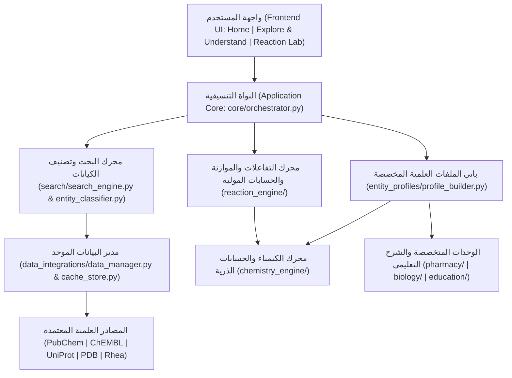

# MolecuLens
**Scientific Learning & Exploration Platform**  
**الشعار:** See Molecules. Understand Science.  
**الفريق التطويري:** BioCode

---

## 1. الفكرة العامة للمنصة
**MolecuLens** هي منصة تعليمية واستكشافية علمية باللغة العربية تتيح للطالب استكشاف المواد العلمية وفهم تركيبها وخصائصها، أو دخول مختبر التفاعلات لتحليل المعادلات والحسابات الكيميائية، دون أن يحتاج الطالب إلى معرفة قواعد البيانات الخلفية أو تفاصيل جلب البيانات؛ إذ تتولى النواة العلمية المشتركة (`Scientific Core`) عمليات البحث، وتصنيف الكيانات، وتوحيد البيانات، وإجراء الحسابات العلمية بدقة وموثوقية.

تتكون المنصة من قسمين رئيسيين فقط:
1. **Explore & Understand:** استكشاف العناصر والمركبات الكيميائية والمواد الدوائية والبروتينات، وعرض معلوماتها الأساسية وتركيبها وبنيتها وخصائصها وتطبيقاتها وتفسيرها العلمي بمستويين (مبسط للطالب وجامعي متقدم).
2. **Reaction Lab:** اختيار مادتين أو أكثر، وتحديد الكميات والوحدات وظروف التفاعل، وتحليل المعادلة الموزونة، والتحقق من حفظ الذرات، وحساب المتفاعل المحدد والفائض والناتج النظري، مع رفض تخمين أو اختلاق التفاعلات غير المدعومة.

---

## 2. المبدأ العلمي الحاكم في MolecuLens
تفصل المنصة برمجيا ومنهجيا بين ثلاث عمليات علمية مستقلة:
- **البحث العلمي (`Scientific Retrieval`):** استرجاع معلومة موثقة موجودة في مصدر علمي معتمد (`PubChem`, `ChEMBL`, `UniProt`, `RCSB PDB`, `Rhea`, `IUPAC`).
- **الحساب العلمي (`Scientific Calculation`):** إجراء عمليات رياضية وكيميائية حتمية وفق القوانين والمعادلات المعتمدة (الكتلة المولية، النسب الذرية، موازنة المعادلات، المتفاعل المحدد، الناتج النظري).
- **التنبؤ العلمي (`Scientific Prediction`):** استخدام نموذج حاسوبي لتقدير خاصية غير مؤكدة مع توضيح حدود الصلاحية.

---

## 3. المخطط المعماري للنظام



---

## 4. هيكلة المشروع البرمجية (11 طبقة معمارية)

| الطبقة / المجلد | المسؤولية الهندسية |
|---|---|
| `frontend/` و `app.py` | عرض الواجهات الحديثة (الصفحة الرئيسية، `Explore & Understand`، و `Reaction Lab`) واستقبال مدخلات الطالب |
| `core/` | تنسيق العمليات (`MolecuLensCore`)، نماذج البيانات الموحدة، والتحقق من المدخلات |
| `search/` | تطبيع النصوص والصيغ، البحث متعدد اللغات، الترتيب الحتمي، وتصنيف الكيانات العلمية |
| `data_integrations/` | `Data Manager` المسؤول عن الاتصال بـ `PubChem` و `ChEMBL` و `UniProt` و `PDB` و `Rhea` وتوحيد البيانات والتخزين المؤقت |
| `entity_profiles/` | إنشاء الملف العلمي المناسب بحسب نوع المادة (`عنصر كيميائي`، `مركب كيميائي`، `مادة دوائية`، `بروتين أو جزيء حيوي`) |
| `chemistry_engine/` | بيانات الجدول الدوري، حساب الكتلة المولية والنسب الذرية، وتحليل البنية الجزيئية عبر `RDKit` |
| `reaction_engine/` | سجل التفاعلات الموثقة، موازنة المعادلات جبريا، حساب المولات والمتفاعل المحدد والناتج النظري، ورفض التفاعلات غير المدعومة |
| `pharmacy/` | المعلومات الدوائية والنشاط الحيوي المنشور ومؤشرات التشابه الدوائي |
| `biology/` | البروتينات والتسلسلات الأمينية والتراكيب الفراغية ثلاثية الأبعاد (`PDB`) |
| `education/` | توليد الشرح العلمي بمستويين (مبسط للطالب / جامعي متقدم) وتوضيح القيود والافتراضات |
| `tests/` | الاختبارات البرمجية الشاملة للتحقق من جميع الطبقات والسيناريوهات الستة الأساسية |

---

## 5. السيناريوهات الأساسية الموثقة والمختبرة
1. **البحث عن `Fe` (`الحديد` / `Iron`):** تصنيفه كـ **عنصر كيميائي** وعرض عدده الذري (`26`) وتوزيعه الإلكتروني (`[Ar] 3d6 4s2`) وخصائصه الفيزيائية دون عرض أقسام بنية جزيئية لا تنطبق عليه.
2. **البحث عن `H2O` (`الماء` / `Water`):** تصنيفه كـ **مركب كيميائي** وعرض الكتلة المولية (`18.015 g/mol`)، التركيب (`ذرتان هيدروجين + ذرة أكسجين`)، البنية المنحنية (`104.45°`)، الخصائص، والتطبيقات.
3. **البحث عن `CO2` (`ثاني أكسيد الكربون`):** البحث المباشر بالصيغ الكيميائية وعرض البنية الخطية (`180°`) والخصائص والتطبيقات.
4. **البحث عن `Sitagliptin` (`سيتاجليبتين`):** تصنيفه كـ **مادة دوائية** وعرض الفئة العلاجية وآلية العمل والنشاط الحيوي الموثق في `ChEMBL`.
5. **تفاعل `H2` مع `O2` في `Reaction Lab`:** موازنة المعادلة ($2\text{H}_2 + \text{O}_2 \rightarrow 2\text{H}_2\text{O}$)، التحقق من حفظ الذرات، وحساب المتفاعل المحدد والناتج النظري وجدول المولات (`ابتدائي` / `مستهلك` / `متبقٍ`).
6. **تفاعل غير مدعوم:** رفض التخمين أو اختلاق النواتج مع عرض سبب الرفض العلمي بوضوح.

---

## 6. طريقة التثبيت والتشغيل والاختبار

### 1. تثبيت المتطلبات
```bash
pip install -r requirements.txt
```

### 2. تشغيل الاختبارات الآلية
```bash
pytest -v
```

### 3. تشغيل المنصة
```bash
streamlit run app.py
```
