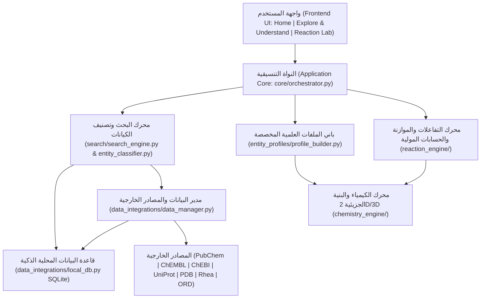

# MolecuLens
**Scientific Learning & Exploration Platform**  
**الشعار:** See Molecules. Understand Science.  
**الفريق التطويري:** BioCode

---

## 1. الفكرة العامة للمنصة
**MolecuLens** هي منصة تعليمية واستكشافية علمية باللغة العربية تتيح للطالب استكشاف المواد العلمية وفهم تركيبها وخصائصها، أو دخول مختبر التفاعلات لتحليل المعادلات والحسابات الكيميائية، دون أن يحتاج الطالب إلى معرفة قواعد البيانات الخلفية أو تفاصيل جلب البيانات؛ إذ تتولى النواة العلمية المشتركة (`Scientific Core`) عمليات البحث، وتصنيف الكيانات، وتوحيد البيانات، وإجراء الحسابات العلمية بدقة وموثوقية.

تتكون المنصة من قسمين رئيسيين:
1. **Explore & Understand:** استكشاف العناصر والمركبات الكيميائية والمواد الدوائية والبروتينات عبر خانة بحث واحدة موحدة وذكية، وعرض معلوماتها الأساسية وتركيبها وبنيتها ثلاثية وثنائية الأبعاد وخصائصها وتطبيقاتها وتفسيرها العلمي بمستويين (مبسط للطالب وجامعي متقدم).
2. **Reaction Lab:** اختيار المواد والكميات والوحدات وظروف التفاعل عبر قوائم مغلقة حصرا، وتحليل المعادلة الموزونة جبريا، والتحقق من حفظ الذرات، وحساب المتفاعل المحدد والفائض والناتج النظري، مع رفض تخمين أو اختلاق التفاعلات غير المدعومة، والتمييز الدقيق بين التفاعل الموثق والنتيجة المحسوبة والتوقع النظري.

---

## 2. إحصائيات قاعدة البيانات العلمية المعتمدة
- **المواد العلمية الموثقة في السجل المحلي:** 241 مادة علمية موثقة ومفهرسة تشمل:
  - 118 عنصرا كيميائيا (الجدول الدوري بالكامل وفق IUPAC بالعربية والإنجليزية).
  - 23 ملحا كيميائيا رئيسيا.
  - 22 مركبا غير عضوي أساسيا.
  - 11 جزيئا حيويا وبروتينا (بما فيها الإنسولين، إنزيم DPP4، الهيموجلوبين، ATP، NADH، اليوريا، السكروز، الجلايسين).
  - 10 أيونات كيميائية موجبة وسالبة.
  - 9 مواد دوائية وصيدلانية (سيتاجليبتين، فيلداجليبتين، ميتفورمين، أسبرين، باراسيتامول، إيبوبروفين، كافيين، أموكسيسيلين، أوميبرازول).
  - 9 قواعد كيميائية قوية وضعيفة.
  - 8 مركبات عطرية (بنزين، تولوين، فينول، أنيلين، نيتروبنزين، نفثالين، حمض البنزويك، حمض الساليسيليك).
  - 7 أحماض معدنية وكيميائية قوية وضعيفة.
  - 5 كحولات عضوية (ميثانول، إيثانول، أيزوبروبانول، بروبانول، جليسرول).
  - 4 أحماض كربوكسيلية عضوية (حمض الخليك CH3COOH، حمض الفورميك HCOOH، حمض الستريك C6H8O7، حمض اللاكتيك C3H6O3).
  - 3 ألدهيدات عضوية (فورمالديهايد، أسيتالديهايد، بنزالديهايد).
  - 3 إسترات عضوية (أسيتات الإيثيل، أسيتات الميثيل، فورمات الميثيل).
  - 2 كيتون عضوي (أسيتون، بيوتانون).
- **المرادفات العلمية المفهرسة محليا:** 1453 مرادفا واختصارا واسما علميا وتجاريا مفهرسا في قاعدة البيانات المحلية لتسريع البحث المباشر.
- **التفاعلات الكيميائية الموثقة:** 87 تفاعلا كيميائيا موثقا وموزونا بدقة، تغطي:
  - تفاعلات التعادل والأحماض والقواعد.
  - تفاعلات الاحتراق الكامل للهيدروكربونات والكحولات.
  - تفاعلات الترسيب والتبادل المزدوج.
  - تفاعلات الإحلال المفرد.
  - تفاعلات الاتحاد والأكسدة والاختزال.
  - تفاعلات التفكك والتحلل الحراري.
  - التفاعلات العضوية (الأسترة، الهدرجة، الهلجنة، النترتة).
  - التفاعلات الكيميائية الحيوية (التنفس الخلوي، التخمر، تحلل ATP، تحلل السكروز واليوريا).

---

## 3. الميزات الهندسية والتطويرية المنفذة

### 1. توحيد خانة البحث (Unified Search Box)
- خانة بحث نصية واحدة وحيدة في واجهة الاستكشاف (`Explore & Understand`).
- لا توجد أي قوائم لاختيار نوع البحث قبل الكتابة؛ إذ يتعرف المحرك تلقائيا على نوع المدخل (`اسم عربي`, `اسم إنجليزي`, `صيغة جزيئية`, `صيغة مكثفة مثل CH3COOH`, `رمز عنصر`, `تمثيل SMILES`, `اسم نظامي IUPAC`).
- دعم الصيغ الجزيئية والمكثفة واختلافات الترقيم السفلي (`H2O` و `H₂O`).

### 2. البحث الذكي والاقتراحات الفورية مع التمييز الأصفر
- اقتراحات فورية أثناء الكتابة تظهر الاسم العربي، والاسم الإنجليزي، والصيغة، والتصنيف العلمي.
- تمييز الحروف أو الكلمات المتطابقة بلون أصفر مميز (`#fef08a` عبر عنصر `<mark class="ml-highlight">`).
- ترتيب النتائج بدقة وفق جودة التطابق ودعم تصحيح الأخطاء الإملائية الشائعة.
- التمييز الصارم بين الصيغ الكيميائية المحددة وعدم الخلط بين المتشابهات أو المصاوغات (مثل التمييز التام بين حمض الخليك `CH3COOH` وفورمات الميثيل `HCOOCH3`).

### 3. قاعدة البيانات المحلية الذكية والتكامل مع المصادر الخارجية
- قاعدة بيانات محلية مدمجة (`SmartLocalDatabase` في `data/moleculens_local.db` عبر SQLite).
- جداول مفهرسة للمواد والمرادفات والتفاعلات، مع منع التكرار، وتوثيق المصدر وتاريخ الجلب والتحديث.
- إدارة الاتصالات الآمنة مع الإغلاق الحتمي لمنع قفل الملفات عبر نظام التشغيل Windows.
- الربط الخارجي مع `PubChem` و `ChEMBL` و `ChEBI` و `UniProt` و `RCSB PDB` و `Rhea` و `Open Reaction Database (ORD)`.

### 4. قوائم الاختيار المغلقة (Closed Dropdowns)
- جميع حقول الاختيار في المنصة عبارة عن قوائم Dropdown مغلقة تماما غير قابلة لكتابة نصوص عشوائية (`pointer-events: none` و `readonly`).
- الاستثناءان الوحيدان: خانة البحث الرئيسية للكتابة، وحقل إدخال الكمية الرقمية (`st.number_input`).

### 5. عارض التراكيب الكيميائية 2D و 3D
- عارض ثنائي الأبعاد (2D) تفاعلي بصيغة SVG يدعم التكبير والتصغير المتدرج وإظهار أرقام الذرات والتحليل البنيوي للروابط (أحادية، ثنائية، ثلاثية، عطرية) والحلقات والمجموعات الوظيفية والكيمياء الفراغية عبر `RDKit`.
- عارض ثلاثي الأبعاد (3D) تفاعلي قابل للتدوير والتكبير يعتمد على نماذج الكرات والعصي المولدة من خوارزميات `ETKDGv3` و `MMFF94/UFF`، مع دمج عارض `3Dmol.js` وتراكيب `PDB` للبروتينات.

### 6. توسيع محرك التفاعلات والفصل الثلاثي للعمليات
- دعم 87 تفاعلا موثقا بدقة موزونة جبريا مع التحقق من حفظ الذرات والكتلة.
- الحسابات الستوكيومترية للمتفاعل المحدد والفائض والناتج النظري وجدول المولات والكتل.
- الفصل الواضح والموثق في نتائج التفاعل بين:
  1. **التفاعل الموثق:** نوع التفاعل والمصدر المرجعي وشروط التفاعل المسجلة.
  2. **النتيجة المحسوبة:** معاملات الموازنة والمتفاعل المحدد والناتج النظري وحفظ الذرات.
  3. **التوقع النظري:** الفرضيات والحدود العلمية ورفض التخمين.

---

## 4. المخطط المعماري للنظام



---

## 5. تشغيل الاختبارات الآلية

تحتوي المنصة على منظومة اختبارات برمجية شاملة تشمل 95 اختبارا آليا بنسبة نجاح 100%:

```bash
pytest -v
```

مخرجات الاختبارات:
- `tests/test_platform_upgrade.py`: 71 اختبارا للتحقق من التعرف على حمض الخليك CH3COOH، والتمييز الأصفر، والبحث الموحد، وقوائم الاختيار المغلقة، ودقة التراكيب 2D/3D، وقاعدة البيانات المحلية، والتفاعلات المتنوعة.
- `tests/test_smart_search.py`: 6 اختبارات لتطابق الصيغ والأسماء متعددة اللغات.
- `tests/test_reaction_engine.py`: 4 اختبارات للموازنة الجبرية وحفظ الذرات والمتفاعل المحدد.
- `tests/test_mvp_scenarios.py`: 6 اختبارات للسيناريوهات المرجعية الأساسية.
- `tests/test_entity_profiles.py`: 4 اختبارات للملفات العلمية للعناصر والمركبات والأدوية والبروتينات.
- `tests/test_core_and_data_manager.py`: 4 اختبارات لتصنيف الكيانات وتوحيد البيانات وسند المعلومة.

---

## 6. تشغيل المنصة

```bash
streamlit run app.py
```
