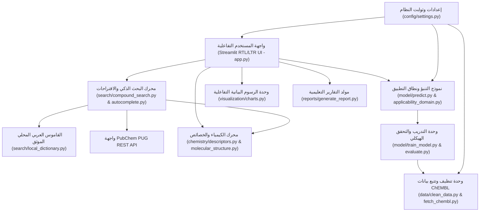
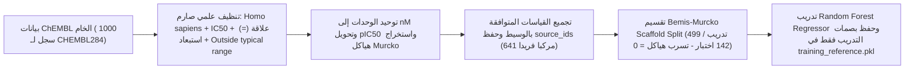

# MolecuLens
**الشعار:** See Molecules. Understand Science.  
**الفريق التطويري:** BioCode

---

## 1. وصف المشروع
**MolecuLens** هو مختبر افتراضي تعليمي باللغة العربية يساعد طلاب الصيدلة والعلوم الصحية والكيمياء على استكشاف المركبات الكيميائية، وفهم خصائصها الفيزيائية الكيميائية، والاطلاع على الأدلة العلمية المنشورة عنها في قاعدة بيانات ChEMBL، والتعرف على كيفية استخدام الذكاء الاصطناعي في التنبؤ بالنشاط الحيوي للمركبات تجاه أهداف بروتينية محددة، مع التركيز في الإصدار الحالي على الهدف البروتيني البشري **DPP4 (Human Dipeptidyl Peptidase-4)**.

---

## 2. المشكلة والحل
### المشكلة
يواجه الطلاب والباحثون المبتدئون صعوبات جوهرية في:
- التعامل مع المصطلحات الإنجليزية والأدوات الحاسوبية المجردة التي تعرض أرقاما صماء دون تفسير علمي.
- البحث عن المركبات باستخدام أسمائها العربية أو صيغها الجزيئية أو اختصاراتها العلمية.
- التمييز بين القياسات المخبرية المنشورة (مثل الفرق بين `IC50` و `Ki`) وبين تنبؤات نماذج الذكاء الاصطناعي.
- إدراك حدود نماذج التعلم الآلي ومعرفة متى يكون المركب الجديد خارج نطاق بيانات تدريب النموذج (Applicability Domain).

### الحل
يوفر **MolecuLens** رحلة تعليمية موجهة تجمع في منصة واحدة بين:
1. محرك بحث ذكي متعدد اللغات والصيغ مع قاموس عربي محلي موثق وربط مباشر بـ PubChem.
2. تحليل الخصائص الكيميائية عبر RDKit مع شرح تعليمي رباعي الأبعاد لكل خاصية.
3. استعراض الأدلة التجريبية المنشورة في ChEMBL مع تتبع معرفات التجارب (`Assay ID`) والوثائق المرجعية (`Document ID`).
4. التنبؤ الحاسوبي بالنشاط الحيوي وتصنيف نطاق التطبيق (`In-Domain` / `Borderline` / `Out-of-Domain`).
5. تجربة تفاعلية («خمّن قبل أن ترى» - Guess Before You See) وتقرير تعليمي يفصل بصريا وعلميا بين الحسابات الكيميائية والأدلة التجريبية وتنبؤات الذكاء الاصطناعي.

---

## 3. الفئة المستهدفة
- طلاب كليات الصيدلة والكيمياء الدوائية والعلوم الصحية.
- طلاب الدراسات العليا والباحثون المبتدئون في الكيمياء الحاسوبية وتصميم الأدوية بمساعدة الحاسوب (CADD).
- أعضاء هيئة التدريس الراغبون في أداة تعليمية تطبيقية لشرح مفاهيم QSAR ونطاق التطبيق وتقسيم الهياكل.

---

## 4. المميزات الرئيسية
- **البحث الذكي والاقتراحات التفاعلية الحية (Smart Search & Interactive Autocomplete):**
  - فصل كامل بين مسار البحث بالصيغ الكيميائية (`CO2`, `H2O`, `O2`, `H2O2`, `C6H12O6`, `C2H6O`, `NH3`, `CH4`) ومسار البحث النصي والتقريبي للأسماء، مع منع استخدام `SequenceMatcher` على الصيغ الكيميائية منعا قاطعا لتجنب النتائج المضللة.
  - ترتيب حتمي للنتائج حسب نوع المطابقة (`Exact Match` ثم `Partial Match` ثم `Approximate Match / Did You Mean`) مع إظهار سبب ظهور كل نتيجة (`match_reason_ar`).
  - استخدام واجهة `PubChem PUG REST` المخصصة للصيغ الكيميائية (`/compound/fastformula/`) بجانب مسار الأسماء (`/compound/name/`)، مع دعم الذاكرة المؤقتة (`Cache`) وتنظيم الطلبات (`Debounce`) ومهلة الاتصال (`Timeout`).
  - معالجة علمية لتعدد المصاوغات المشتركة في الصيغة الواحدة (مثل `C6H12O6` للجلوكوز والفركتوز والجلاكتوز، و `C2H6O` للإيثانول وثنائي ميثيل الإيثر) دون اختيار مركب عشوائي.
  - قائمة اقتراحات تفاعلية قابلة للاختيار تعرض الاسم العربي والإنجليزي والصيغة والمعرفات (`PubChem CID` و `ChEMBL ID`) ومعاينة البنية ثنائية الأبعاد، مع عزل منطقة البحث عبر `@st.fragment` ومفتاح حالة ثابت يحفظ نص البحث عند تغيير نوع التصفية.
- **التحقق الصارم من هوية المركب (Compound Identity Verification):** التحقق الرباعي عبر RDKit من صلاحية `SMILES`، واستخراج الصيغة الجزيئية، ومطابقتها مع الصيغة الأصلية المسجلة، والتأكد من وجود معرف مرجعي موثق قبل السماح ببدء التحليل.
- **القاموس المحلي والمسار البديل (Fallback Search):** عمل كامل للمركبات المعتمدة دون اتصال بالإنترنت، مع الاتصال بـ PubChem عند الحاجة.
- **مكتبة المركبات التجريبية لـ DPP4:** بطاقات موثقة لمثبطات DPP4 الخمسة (`Sitagliptin`, `Vildagliptin`, `Saxagliptin`, `Linagliptin`, `Alogliptin`).
- **تحدي Guess Before You See:** إلزام الطالب ببناء فرضيته العلمية قبل إظهار مقارنة النموذج دون أي قيم افتراضية مسبقة.
- **تصنيف نطاق التنبؤ (Applicability Domain):** تصنيف كل مركب إلى `داخل النطاق – In-Domain` أو `حدّي – Borderline` أو `خارج النطاق – Out-of-Domain`.

---

## 5. رحلة المستخدم (المراحل الخمس للمختبر الافتراضي)
1. **نقطة الدخول:** البحث الذكي عن المركب وتأكيد هويته البنائية والمعرفية عبر بطاقة التحقق.
2. **المرحلة الأولى (اختيار الهدف البروتيني):** دراسة إنزيم `DPP4` البشري (`UniProt: P27487` | `ChEMBL: CHEMBL284` | `Homo sapiens`) وعلاقته بأبحاث السكري.
3. **المرحلة الثانية (تحليل الخصائص الكيميائية):** حساب الوزن الجزيئي، `LogP`، `HBD`، `HBA`، الروابط الدوارة، `TPSA`، قاعدة `Lipinski`، وفحص `PAINS` مع تفسير تعليمي لكل مؤشر.
4. **المرحلة الثالثة (الأدلة العلمية المنشورة):** عرض القياسات المخبرية في ChEMBL، معرفات التجارب والوثائق، الوسيط الحسابي (`Median Activity`) وعدد القياسات (`Measurement Count`).
5. **المرحلة الرابعة (التنبؤ بالنشاط الحيوي باستخدام AI):** تجربة `Guess Before You See`، تصنيف نطاق التطبيق، عرض تشابه `Tanimoto` مع مركبات التدريب فقط، ومخرجات نموذج Random Forest.
6. **المرحلة الخامسة (التقييم النهائي والتقرير التعليمي):** مقارنة شاملة تفصل بين الخصائص المحسوبة والأدلة التجريبية والتنبؤات الحاسوبية مع إمكانية تصدير التقرير.

---

## 6. المخطط المعماري ومخطط تدفق البيانات (Architecture & Data Flow Diagrams)

### المخطط المعماري للنظام (System Architecture)


### مخطط تدفق البيانات (Data Flow Pipeline)


---

## 7. التقنيات المستخدمة

| التقنية | الإصدار المعتمد | الاستخدام |
|---|---|---|
| **Python** | 3.11+ | لغة البرمجة الأساسية |
| **Streamlit** | 1.67.0 | بناء واجهة المختبر الافتراضي التفاعلية |
| **RDKit** | 2026.9.1 | التحقق من البنية الجزيئية، استخراج البصمات، وحساب الخصائص وفحص PAINS |
| **Scikit-Learn** | 1.9.1 | تدريب نموذج Random Forest وحساب مقاييس التقييم |
| **Pandas** | 3.1.1 | معالجة وتنظيف وتجميع الجداول العلمية |
| **NumPy** | 2.4.6 | العمليات المصفوفية وحساب تشابه Tanimoto السريع |
| **Plotly** | 7.1.0 | الرسوم البيانية التفاعلية |
| **Pytest** | 9.2.0 | الاختبارات الآلية الشاملة |
| **GitHub Actions** | v4 / v5 | التكامل المستمر وتشغيل الاختبارات تلقائيا |

---

## 8. مصادر البيانات العلمية
1. **ChEMBL Database (EMBL-EBI):** بيانات النشاط الحيوي المخبرية لإنزيم DPP4 البشري (`CHEMBL284`).
2. **UniProt Knowledgebase:** المعلومات الوظيفية والمرجعية لبروتين DPP4 البشري (`P27487`).
3. **PubChem (NCBI):** البحث عن المركبات، المرادفات، الأسماء العلمية، والصيغ الجزيئية.

---

## 9. طريقة تنظيف البيانات (ChEMBL Data Cleaning Policy)
تم تطبيق سياسة تنظيف علمية موثقة في `data/clean_data.py` وتقرير `data/processed/cleaning_report.json`:
- **إجمالي السجلات الخام:** `1000` سجل.
- **تحديد الهدف والكائن الحي:** التحقق من `target_id = CHEMBL284` و `target_organism = Homo sapiens`.
- **تحديد نوع القياس والعلاقة:** الاقتصار على قياسات `IC50` ذات العلاقة الكمية الدقيقة `=` (استبعاد `141` سجلا ذا علاقات حدية مثل `>` أو `>>` و `5` سجلات مفقودة القيمة).
- **مراجعة صلاحية البيانات ونوع التجربة:** استبعاد `78` سجلا يحمل تحذير `Outside typical range`، و `36` سجلا من خارج تجارب الربط المباشر (`Assay Type = B`).
- **توحيد الوحدات:** تحويل `17` سجلا مقاسا بوحدة `ug.mL-1` إلى `nM` باستخدام الوزن الجزيئي الدقيق للجزيء، وحساب `pIC50 = 9 - log10(IC50_nM)`.
- **معالجة التكرارات والتجميع:** استبعاد `35` سجلا متكررا متضاربا (فرق يتجاوز `1.0 pIC50`)، وحساب الوسيط (`median_activity`) وعدد القياسات (`measurement_count`) مع حفظ جميع معرفات التجارب والمراجع الأصلية في `source_ids`.
- **الحصيلة النهائية:** `641` مركبا فريدا موزعا على `231` هيكلا أساسيا (`Bemis-Murcko Scaffolds`) عبر `38` تجربة و `34` مرجعا علميا.

---

## 10. منهجية النموذج ومقارنة طرق تقسيم البيانات (Random Split vs Scaffold Split)
تم تدريب نموذج `RandomForestRegressor` (`n_estimators=300, random_state=42`) للتنبؤ بقيمة `pIC50` اعتمادا على بصمات `Morgan Fingerprints` (`radius=2, 1024 bits`).

### نتائج التقييم الفعلية للنموذج (`models/model_metrics.json`)

| المقياس | Random Split (تقسيم عشوائي 80/20) | Scaffold Split (تقسيم الهياكل المعتمد) | التفسير العلمي |
|---|---|---|---|
| **عدد مركبات التدريب / الاختبار** | 512 / 129 | 499 / 142 | تقسيم متوازن بنفس البذرة العشوائية (`Seed = 42`) |
| **الهياكل الأساسية المشتركة المتسربة** | **41 هيكلا مشتركا** | **0 (صفر)** | منع تام لتسرب الهياكل في Scaffold Split |
| **MAE (خطأ pIC50 المطلق)** | 0.5110 | **0.7713** | يعكس الخطأ المتوقع الفعلي على عائلات كيميائية جديدة |
| **RMSE (جذر متوسط مربع الخطأ)** | 0.7330 | **1.1210** | حساس للأخطاء الكبيرة الناتجة عن قفزات النشاط |
| **R² (معامل التحديد العددي)** | 0.5311 | **0.3565** | يوضح كيف يضخم التقسيم العشوائي قيمة R² ظاهريا |
| **ROC-AUC (للتمييز التصنيفي عند 1000 nM)** | 0.9128 | **0.8829** | يقيس قدرة الترتيب التصنيفي وليس دقة قيمة IC50 العددية |

---

## 11. طريقة التثبيت والتشغيل والاختبار

### 1. تثبيت المتطلبات
```bash
pip install -r requirements.txt
```

### 2. تنظيف البيانات وتدريب النموذج
```bash
python clean_data.py
python train_model.py
```

### 3. تشغيل الاختبارات الآلية (Pytest)
```bash
pytest -v
```

### 4. تشغيل واجهة المختبر الافتراضي
```bash
streamlit run app.py
```

---

## 12. حدود المشروع العلمية (Project Limitations)
- **MolecuLens** مشروع تعليمي تدريبي للفرز الحاسوبي الأولي؛ لا يكتشف أدوية جديدة ولا يثبت فعاليتها السريرية ولا يقدم استشارات طبية أو علاجية.
- يقتصر النموذج على التنبؤ بقياسات `IC50` لإنزيم DPP4 البشري ولا يجوز خلطها بقياسات `Ki`.
- تصنيف نطاق التطبيق (`In-Domain` / `Borderline` / `Out-of-Domain`) يعبر عن مدى تمثيل المركب في فضاء التدريب الكيميائي وليس احتمالا إحصائيا لصحة التنبؤ.

---

## 13. التراخيص ومصادر البيانات
- يخضع الكود المصدري للمشروع لترخيص **MIT License** (انظر ملف [LICENSE](file:///c:/Users/LENOVO/Desktop/Hackathon/LICENSE)).
- تخضع المكتبات البرمجية والبيانات العلمية الخارجية لتراخيصها وشروط الإسناد الموثقة تفصيلا في ملف [SOURCES_AND_LICENSES.md](file:///c:/Users/LENOVO/Desktop/Hackathon/SOURCES_AND_LICENSES.md).

---

## 14. الفريق والمساهمون
- **اسم الفريق:** BioCode
- **المشروع:** MolecuLens — هاكاثون شراع 2026 (مسار الصحة وجودة الحياة)
